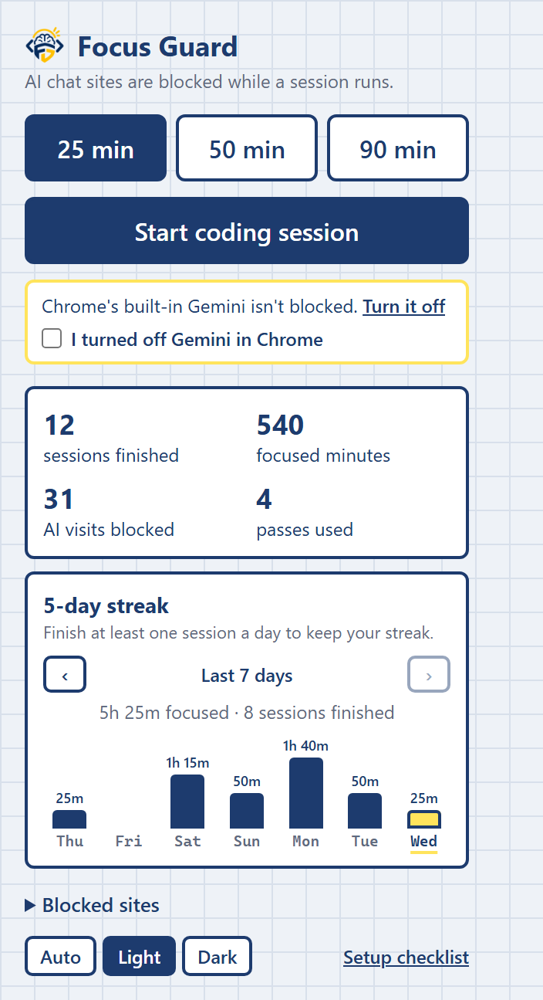
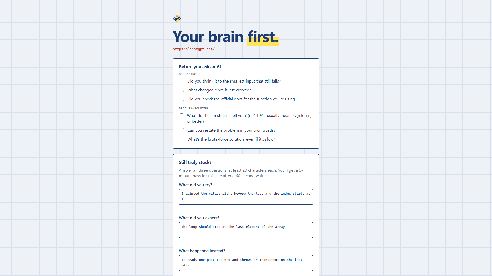
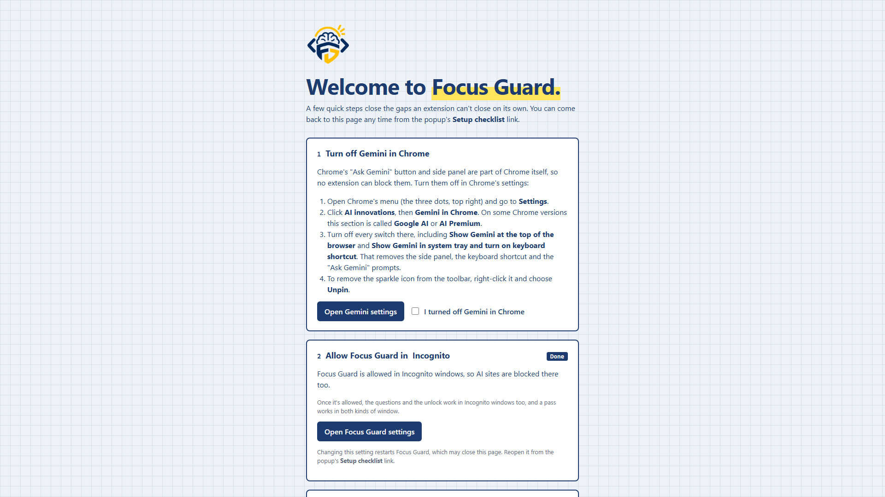

# Focus Guard: Code Without the Crutch

A browser extension for Google Chrome and Microsoft Edge that blocks AI chat sites while you code, so you try solving the problem yourself first.

**Website:** [focus-gaurd.netlify.app](https://focus-gaurd.netlify.app/)

## Why I built this

Recently, whenever I sat down to solve problems on LeetCode, CodeChef, or HackerRank, my hand would automatically move toward ChatGPT or Gemini. Instead of thinking through the problem, I'd paste it in, copy the answer, and submit. That's plagiarism, and worse, I wasn't actually learning anything.

I built Focus Guard to break that habit. It doesn't ban AI completely. It just adds enough friction that I have to try solving the problem myself first. If I'm genuinely stuck after really trying, I can still get help, but only after writing down what I've attempted.

## The problem

You hit a bug. Before you've even finished reading the error, a new tab is open and you're pasting it into ChatGPT or Gemini.

It feels productive, but it skips the part where you actually learn: reading the stack trace, poking at the code, forming a guess and checking it. Do that every day and you get faster at asking, not at debugging.

## How Focus Guard solves it

Focus Guard doesn't ban AI. It adds **friction**.

While a coding session is running, AI chat sites are swapped out for a "Your brain first." page. It gives you a few questions to try first. If you're still stuck, you can unlock the site:

1. Answer three questions: what you tried, what you expected, and what happened instead (at least 20 characters each, and no random typing).
2. Wait 60 seconds. Use the time to try one more idea.
3. Get a 5-minute pass for that one site. Every other AI site stays blocked. Before you open the site, **Copy as AI prompt** puts your three answers on the clipboard with a request for a hint rather than the full solution.

Most of the time, writing the problem down or waiting that minute is enough to get you unstuck on your own. When it isn't, the AI is still there.

## Features

- **Timed coding sessions** of 25, 50 or 90 minutes, with a countdown in the popup and minutes left shown on the toolbar icon.
- **Blocks AI chat sites only during a session.** Outside a session, everything works normally.
- **Catches tabs that are already open.** Any AI tabs open when you start a session get redirected too.
- **Blocks AI features inside normal sites**, like GitHub Copilot, Grok on X and Google's AI Mode, without blocking the rest of those sites.
- **Rotating questions** on the block page: 3 debugging and 3 problem-solving questions, picked at random from a larger pool each time it opens, like "What changed since it last worked?" or "What do the constraints tell you?"
- **Earned 5-minute passes** after you answer three questions about what you tried and wait 60 seconds. A pass only unlocks the site you were stuck on, and you can copy your answers as a ready-made prompt that asks for a hint, not the answer.
- **Pass notifications** one minute before a pass ends, when it ends, and when it moves to another site.
- **Your own blocklist.** Add or remove sites from the popup. The list is locked during a session so you can't quietly remove a site to get around the block.
- **Simple stats**: sessions finished, focused minutes, AI visits blocked and passes used, plus a **daily streak** and a **weekly chart** of your focused minutes.
- **Optional AI app builders group** (v0.app, bolt.new, lovable.dev), off unless you turn it on.
- **Dark mode** that follows your system, or pick Light or Dark in the popup.
- **Works in Incognito and InPrivate windows** too, block page and all, once you allow it.

## Screenshots

*The popup: pick a session length, start a session and see your stats.*

*The block page: questions to try first, then a 5-minute pass if you're still stuck.*

*The setup checklist that opens on first install.*

## Installation

Focus Guard isn't in a browser store. In both Chrome and Edge, you install it from GitHub with **Load unpacked**:

1. Download [focus-guard.zip](https://github.com/rishi555123/focus-guard/releases/latest/download/focus-guard.zip). This link always gets the newest version. Every version is on the [Releases page](https://github.com/rishi555123/focus-guard/releases).
2. Extract it into a folder you'll keep, like `Documents\focus-guard`. Your browser loads Focus Guard from that folder, so deleting or moving the folder removes the extension.
3. Open the extensions page: `chrome://extensions` in Chrome, or `edge://extensions` in Edge.
4. Turn on **Developer mode**. In Chrome the switch is in the top-right corner; in Edge it's in the left-hand panel.
5. Click **Load unpacked** and select the extracted folder (the one with `manifest.json` in it).
6. Optional: click the puzzle-piece **Extensions** button in the toolbar, then the pin (Chrome) or the eye icon (Edge) next to Focus Guard, so it's easy to reach.

Your browser may show a message about extensions in developer mode, for example when it starts. That's expected for anything installed with Load unpacked. Close it and keep Focus Guard on.

**Updating:** download the new zip, delete everything inside your Focus Guard folder, extract the new zip into that same folder, and click the reload icon on the Focus Guard card on the extensions page. Keep using the same folder: your browser recognises Focus Guard by its folder, so that keeps your blocklist, stats and settings.

### After installing

Focus Guard opens a short setup checklist:

- **In Chrome:** turn off Gemini in Chrome, allow Focus Guard in Incognito, and allow Chrome notifications in Windows.
- **In Edge:** optionally turn off Copilot in Edge, allow Focus Guard in InPrivate, and allow Edge notifications in Windows.

You can reopen it any time from the **Setup checklist** link in the popup.

Working on the code? See [CONTRIBUTING.md](CONTRIBUTING.md) for loading it straight from a clone of this repository.

## How to use it

1. Click the Focus Guard icon in your toolbar.
2. Pick a session length: 25, 50 or 90 minutes.
3. Click **Start coding session**.
4. Code! If you open an AI chat site, you'll land on the "Your brain first." page instead.
5. Work through the checklist. Still stuck? Answer the three questions, wait out the 60 seconds and use your 5-minute pass. Click **Open** when you're ready, or **Copy as AI prompt** first.
6. When the timer runs out, the session counts as finished and sites unblock automatically. You can also click **End session early**, but then it won't count as finished.

To change which sites are blocked, open the popup when no session is running. Expand **Blocked sites**, put one site per line and click **Save sites**. Subdomains are covered automatically.

- A site, like `chatgpt.com`, blocks the whole site.
- A site with a path, like `github.com/copilot`, blocks just that page and the pages under it.
- A path can also need one `name=value` part of the address, like `google.com/search?udm=50`, which blocks Google's AI Mode but not normal searches.

You can paste full links too: `https://www.chatgpt.com/` is saved as `chatgpt.com`, and `https://github.com/copilot` as `github.com/copilot`. A pasted link keeps its path, so if you meant the whole site, remove everything after the site name. The popup points out entries that block only part of a site, and leaves out entries that another line already covers. If a line isn't a site, nothing is saved and the popup tells you which line to fix.

Tick **Also block AI app builders** to block v0.app, bolt.new and lovable.dev as well. Turning it off again never removes sites you added yourself.

## Blocked sites

These are blocked by default, including all their subdomains:

| Service | Domains |
| --- | --- |
| ChatGPT | `chatgpt.com`, `chat.openai.com` |
| Google Gemini and AI Studio | `gemini.google.com`, `aistudio.google.com` |
| Claude | `claude.ai` |
| Microsoft Copilot | `copilot.microsoft.com`, `copilot.cloud.microsoft` |
| Perplexity | `perplexity.ai` |
| DeepSeek | `deepseek.com` |
| Mistral Le Chat | `chat.mistral.ai` |
| Meta AI | `meta.ai` |
| Qwen | `chat.qwen.ai` |
| Kimi | `kimi.com`, `kimi.moonshot.cn` |
| Z.ai (GLM) | `chat.z.ai` |
| Grok | `grok.com` |
| Poe | `poe.com` |
| You.com | `you.com` |
| Phind | `phind.com` |
| Blackbox AI | `blackbox.ai` |
| LMArena | `lmarena.ai` |
| Duck.ai | `duck.ai` |
| Pi | `pi.ai` |
| T3 Chat | `t3.chat` |
| TypingMind | `typingmind.com` |

These AI features inside other sites are blocked too, without blocking the rest of the site:

| Feature | Entry |
| --- | --- |
| GitHub Copilot on github.com | `github.com/copilot` |
| Grok on X | `x.com/i/grok` |
| Copilot on Bing | `bing.com/chat` |
| HuggingChat | `huggingface.co/chat` |
| Google Search AI Mode | `google.com/search?udm=50` |

If you already have Focus Guard, new sites on this list are added to your blocklist when the extension updates. Any site you removed yourself stays removed.

## Known limitations

Focus Guard blocks websites by their address, so some AI tools are out of its reach:

- **Chrome's "Ask Gemini" button and side panel.** Chrome's Gemini panel is part of Chrome itself, not a tab, and Chrome deliberately keeps extensions out of it for security, so no extension can block it. You can turn it off yourself:
  1. Open Chrome's menu (the three dots, top right) and go to **Settings**.
  2. Click **AI innovations**, then **Gemini in Chrome**. On some Chrome versions this section is called **Google AI** or **AI Premium**.
  3. Turn off every switch there, including **Show Gemini at the top of the browser** and **Show Gemini in system tray and turn on keyboard shortcut**. That removes the side panel, the keyboard shortcut and the "Ask Gemini" prompts.
  4. To remove the sparkle icon from the toolbar, right-click it and choose **Unpin**.

  The setup checklist has a button that opens this settings page for you.
- **Edge's Copilot button and sidebar.** The Copilot sidebar is part of Edge itself, not a tab, so Focus Guard can't block it, even though it blocks the `copilot.microsoft.com` website. You can turn it off yourself:
  1. Open Edge's menu (the three dots, top right) and go to **Settings**.
  2. Click **Appearance**, then **Copilot and sidebar**, then **Copilot**. On older Edge versions this is under **Sidebar**, then **Copilot**.
  3. Turn off **Show Copilot button on the toolbar** and **Allow Microsoft to access page content**.
  4. To hide the whole sidebar too, go back to **Copilot and sidebar** and turn the sidebar off.

  In Edge, the setup checklist shows this as an optional step, with a button that opens the settings page.
- **AI assistants in your code editor**, like GitHub Copilot, Cursor or other extensions in VS Code and JetBrains. Focus Guard only works inside your browser. Most editors let you pause their AI features while you practise.
- **Google AI Overviews**, the AI summaries at the top of normal Google search results. They're part of the search page itself, so blocking them would mean blocking Google Search.
- **AI features inside other sites that aren't on the list.** Focus Guard blocks the AI parts of GitHub, X, Bing, Hugging Face and Google Search listed above, and you can add others by their address. AI built into a page you otherwise need, with no address of its own, can't be blocked. Google AI Mode is only blocked on `google.com`, not on country sites like `google.co.uk`; add `google.co.uk/search?udm=50` yourself if you use one.
- **Incognito windows (InPrivate in Edge)**, unless you allow Focus Guard there. The popup reminds you and has a button that opens the right settings page. Turn on **Allow in Incognito** in Chrome, or **Allow in InPrivate** in Edge.
- **The first page in a new Incognito or InPrivate window may flash light or dark.** Focus Guard runs a separate copy of itself in private windows, so the questions, the unlock and passes work there too. That copy keeps its own short-lived copy of your Light or Dark theme choice, so the first Focus Guard page it shows can briefly appear in the other theme. Auto isn't affected.
- **Desktop and phone apps**, like the ChatGPT, Claude or Copilot apps. These run outside your browser.

## Privacy

Everything stays on your computer. The full privacy policy is in [PRIVACY.md](PRIVACY.md).

- Your sessions, stats (including your daily totals for the streak and chart), blocklist, settings and the unlock notes you write are saved only in `chrome.storage.local` in your own browser.
- Focus Guard has no servers, no analytics and no tracking, and it never sends your data anywhere.
- It asks for access to all sites so it can spot when you open a blocked site and redirect that tab to the block page. It doesn't read or collect the content of the pages you visit.

Uninstalling the extension deletes all of its data. Your browser then opens the [Removed Focus Guard?](#removed-focus-guard) section below. That's a normal page visit; nothing about you is sent with it.

## Removed Focus Guard?

Thanks for trying it! If you turned off your browser's built-in AI during setup, here's how to turn it back on.

**Gemini in Chrome:**

1. Open Chrome's menu (the three dots, top right) and go to **Settings**.
2. Click **AI innovations**, then **Gemini in Chrome**. On some Chrome versions this section is called **Google AI** or **AI Premium**.
3. Turn the switches you want back on, like **Show Gemini at the top of the browser** and **Show Gemini in system tray and turn on keyboard shortcut**.
4. To bring back the sparkle icon, right-click the top of the browser and choose **Pin Gemini**.

**Copilot in Edge:**

1. Open Edge's menu (the three dots, top right) and go to **Settings**.
2. Click **Appearance**, then **Copilot and sidebar**, then **Copilot**. On older Edge versions this is under **Sidebar**, then **Copilot**.
3. Turn **Show Copilot button on the toolbar** back on, and anything else you turned off there.

Anything else you changed during setup, like allowing Focus Guard in Incognito or InPrivate, went away with the extension. Browser notifications in Windows can stay on; other apps and sites use them too.

Have a minute? [Open an issue](https://github.com/rishi555123/focus-guard/issues) and tell us why you removed it.

## Contributing

Ideas, bug reports and pull requests are all welcome!

- **Found a bug or have an idea?** Open an issue and tell us what happened or what you'd like to see.
- **Want to add a site to the default list?** Add it to `DEFAULT_SITES` at the top of `src/background/background.js`.
- **Making a change?** Keep it small and focused. Reload the extension in `chrome://extensions` (or `edge://extensions`) and test it by starting a session, visiting a blocked site and going through the unlock flow.

There's no build step. It's plain HTML, CSS and JavaScript, so you can start editing right away.

Here's a quick map of the files:

| File | What it does |
| --- | --- |
| `manifest.json` | Extension settings and permissions |
| `src/background/background.js` | Runs sessions, timers, blocking rules and stats |
| `src/popup/popup.html` / `popup.js` | The toolbar popup |
| `src/blocked/blocked.html` / `blocked.js` | The "Your brain first." page |
| `src/blocked/links.js` | Reads the block page's address and works out where "Back to my code" goes |
| `src/shared/style.css` | Shared graph-paper styling |
| `src/shared/sites.js` | Cleans what you type into the blocklist, and matches addresses against whole-site and part-of-a-site entries |
| `src/shared/constants.js` | Session lengths, the pass length, unlock limits and how many days of history to keep, in one place |
| `src/shared/reason.js` | Checks the three unlock answers and builds the copied AI prompt |
| `src/shared/streaks.js` | The daily history behind the streak and the weekly chart |
| `src/shared/theme.js` | Applies the light or dark theme before each page draws |
| `src/shared/setup.js` | Setup buttons shared by the popup and the welcome page |
| `src/shared/browser.js` | Tells Edge from Chrome, with each browser's wording and settings pages |
| `src/blocked/questions.js` | The pool of block page questions; add new ones here |
| `src/welcome/welcome.html` / `welcome.js` | The setup checklist that opens on first install |
| `icons/` | Extension and toolbar icons, and the logo for Focus Guard's own pages |
| `docs/screenshots/` | Screenshots for the docs |
| `docs/brand/` | The original logo files, and `make-icons.py`, which makes every icon from them |
| `site/` | The project website: plain HTML and CSS, ready for Netlify with no build step |
| `netlify.toml` | Tells Netlify to publish `site/` |
| `tests/` | Tests for the background logic, the popup and block page, blocklist input, unlock answers, streaks, themes, icons, the manifest and the website (run with `node --test`) |
